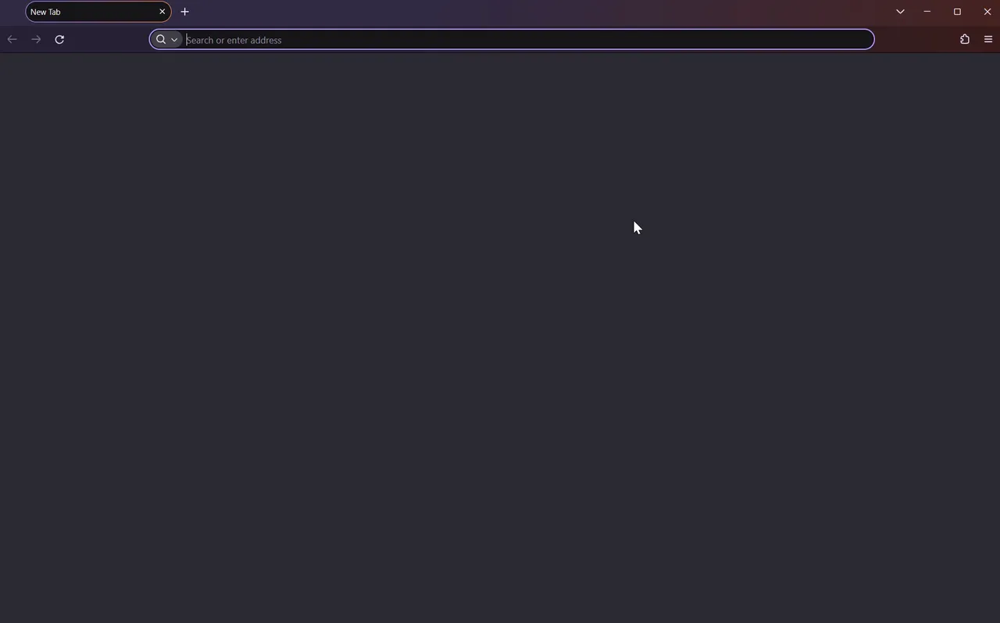

<section>
  <h3 align="center"> Ignis</h3>

  <p align="center">
    Run Obsidian in the browser. No remote desktop required.
  </p>

  <p align="center">
    
  </p>

  <h3 align="center">
    <a href="https://ignis.thiefling.com/docs/server/deploy/">Setup instructions</a>
  </h3>

  <p align="center">
    <a href="https://ignis.thiefling.com/docs/">Documentation</a>
  </p>

  <p align="center">
    <a href="https://dev.thiefling.com/ignis/"></a>
    <a href="https://discord.gg/rgyXBAeNMM"></a>
  </p>
</section>

## What is this

Ignis is a compatibility shim that provides browser-compatible implementations of the Electron APIs used by Obsidian, allowing Obsidian to run in a standard browser while keeping your vault on the server. Obsidian is not included in or distributed with this project. The Docker container downloads Obsidian directly from its official source on first run.

### Why

While Obsidian's local-first approach works well for most users, options for accessing your own Obsidian installation remotely have been limited to VNC-based solutions with poor user experience. Ignis provides an alternative for users who want to access their own copy of Obsidian from a browser, in a close-to-native format.

### Project Status

Ignis is under active development as my daily driver for note taking. It's still a new project, so gaps get documented and fixed as I go. You can look at the [roadmap](https://ignis.thiefling.com/docs/roadmap/) for an overview of major planned fixes and features.

## Quick start

Run Ignis with Docker Compose. Use the following compose file for a basic setup.

```yaml
services:
  ignis:
    image: nobbe/ignis:latest
    ports:
      - "8080:8080"
    environment:
      # match these to your host user (run: id)
      - PUID=1000
      - PGID=1000
    volumes:
      - ./vaults:/vaults
      - ./data:/app/data
      - obsidian-app:/app/obsidian-app
    restart: unless-stopped

volumes:
  obsidian-app:
```

Save it as `docker-compose.yml`, then run `docker compose up -d` and open `http://localhost:8080`. The first start pulls Obsidian from its official source, so give it a minute or two. With no vaults yet, Ignis opens the vault manager to create your first one.

> [!IMPORTANT]
> Before exposing Ignis to other machines, put authentication in front of it and serve it over HTTPS. It has no built-in auth, so anyone who reaches an open instance can read and write the whole vault, and outside a secure context (HTTPS, or `localhost`) the browser disables features Ignis needs. See [Remote access](https://ignis.thiefling.com/docs/security/remote-access/) and [Authentication](https://ignis.thiefling.com/docs/security/authentication/).

Full setup and configuration are in the [deploy guide](https://ignis.thiefling.com/docs/server/deploy/); the rest of the [documentation](https://ignis.thiefling.com/docs/) covers settings, security, and operations.

## Variants

Ignis currently ships as a self-hosted server, with a desktop plugin variant planned. The server variant lives in [`apps/ignis-server/`](apps/ignis-server/); setup is in the [documentation](https://ignis.thiefling.com/docs/server/deploy/).

## Features

- Core Obsidian: editor, canvas, bases, command palette, context menus, themes, and CSS snippets.
- Most community plugins built on Obsidian's plugin API. Plugins needing Node native modules or `child_process` do not load.
- File upload (ribbon, right-click, drag-and-drop) and download (files, or folders as ZIP).
- Multi-vault support with create, open, switch, rename, and delete, and a different vault per browser tab.
- Live sync between tabs over WebSocket, so edits propagate within a second.
- Saved workspaces opened in separate tabs via a `?workspace=` URL parameter.
- Notes can be opened directly by URL via a `?file=` parameter, with an "as Ignis URL" option in the note menu 'Copy path' section.
- Obsidian Sync in a logged-in tab, or server-side Headless Sync that runs without a tab open.
- A cross-origin proxy for plugin requests, with a direct-fetch allowlist for CORS-friendly hosts.
- A mobile UI on small screens.
- Saving Ignis to the home screen or desktop as a standalone window.

See the [documentation](https://ignis.thiefling.com/docs/) for the full feature set and setup.

## Limitations

Running Obsidian in a browser means some Electron and Node capabilities have no equivalent, so certain plugins and features are limited or unavailable. See [Limitations](https://ignis.thiefling.com/docs/using/limitations/) and [Plugin compatibility](https://ignis.thiefling.com/docs/using/plugin-compatibility/) for details.

## Performance

A few design decisions worth knowing about for someone evaluating Ignis against large vaults or slow storage:

- A pre-compressed bootstrap response delivers vault info, vault list, metadata tree, and plugin list in a single call.
- The vault file tree is kept up to date by live file events.
- Indexer pre-fetch warms the content cache so Obsidian's startup index hits cache instead of the network.
- Reading a note that is not in the content cache also fetches other uncached notes in one request, as long as the cache has room for them.
- An LRU content cache (50 MB by default) keeps memory use bounded regardless of vault size, so Ignis doesn't hold the whole vault in memory.
- Paths can be excluded from file watching to reduce watcher load on large vaults.
- Write coalescing can be turned on to debounce rapid writes on slow filesystems such as rclone, FUSE, NFS, or SMB mounts. It is set with the 'Write coalesce window' setting or `WRITE_COALESCE_MS`.

See [Settings](https://ignis.thiefling.com/docs/using/settings/) for more in-depth descriptions.

## Contributing

Contributions are welcome. See [CONTRIBUTING.md](CONTRIBUTING.md) for guidelines, especially on how to report plugin compatibility issues. Check the [open issues](https://github.com/Nystik-gh/ignis/issues) for things to work on.

## Architecture

See [ARCHITECTURE.md](docs/ARCHITECTURE.md) for details on the shim layer, plugin system, and server internals.

## License

This project is licensed under the [GNU Affero General Public License v3.0](LICENSE).

## Legal Notice

Ignis is not affiliated with, endorsed by, or associated with Dynalist Inc. or Obsidian. It is an independently developed interoperability tool and contains no Obsidian source code, binaries, or assets. No part of Obsidian is distributed or included in this repository; the Docker container downloads Obsidian directly from its official source at runtime.

This work falls under the interoperability provisions of [Directive 2009/24/EC](https://eur-lex.europa.eu/eli/dir/2009/24/oj/eng) (the EU Software Directive), Article 6. See [LEGAL.md](LEGAL.md) for the full rationale.

This project exists because its author uses Obsidian daily and wants to access it from a browser. There is no intent to harm Obsidian, Dynalist Inc., or their business. If you are a representative of Dynalist Inc. and wish to discuss this project, please reach out: ignis@thiefling.com
